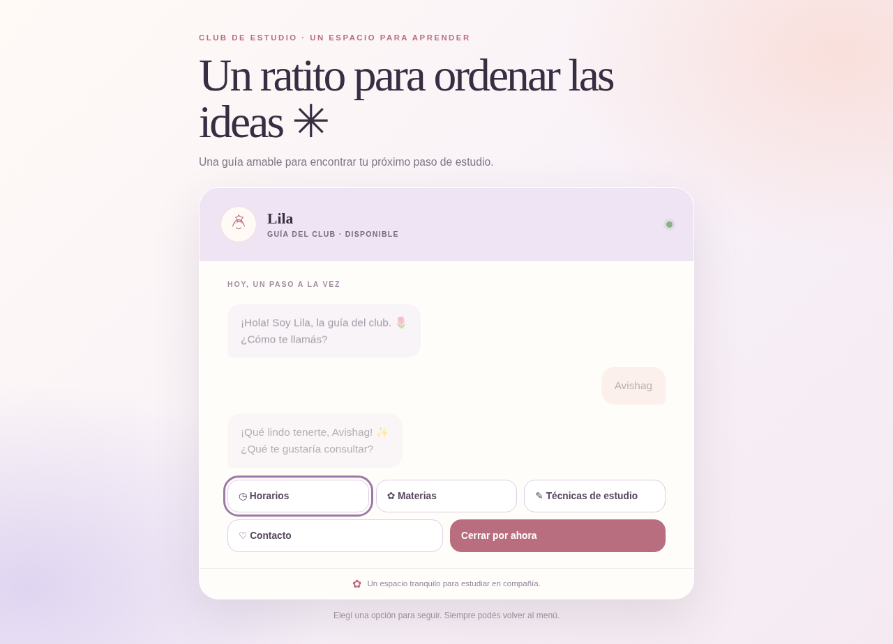
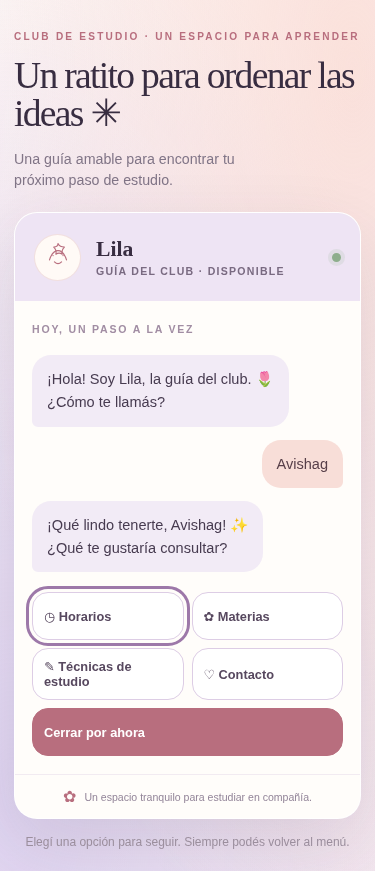

# Chatbot del club de estudio

## 🧩 Datos generales

| Campo | Detalle |
| --- | --- |
| Integrante 1 | Avishag Sadrinas |
| Integrante 2 | No corresponde: trabajo individual |
| Modelos de IA utilizados | GPT-6.2 Sol y GPT-6 Luna |
| Tecnologías | HTML, CSS, JavaScript, JSON, diagrams.net, Notion y GitHub Pages |
| Tema | Orientación para integrantes del club de estudio |
| Repositorio | [chatbot-club-estudio](https://github.com/avishagsad/chatbot-club-estudio) |
| Sitio publicado | [Abrir chatbot](https://avishagsad.github.io/chatbot-club-estudio/) |

---

## 📄 Sketch

**Archivo editable:** [sketch-chatbot.drawio](evidencias/sketch-chatbot.drawio)


El sketch se hizo antes del prompt y define la presentación, la conversación, los botones y el reinicio.

---

## 💬 Prompt utilizado

```txt
Implementá un chatbot web del club de estudio siguiendo el sketch registrado. Pedí los archivos index.html, style.css, script.js y arbol_decision.json. La conversación debe manejarse con botones y todos los textos, opciones y destinos deben vivir en el JSON. El bot debe pedir y recordar el nombre, usarlo mediante {nombre}, mostrar un menú con horarios, materias, técnicas de estudio y contacto, ofrecer volver al menú después de cada respuesta y permitir finalizar o reiniciar. script.js debe cargar y validar el JSON, avisar si un destino no existe y explicar que se necesita un servidor local cuando el archivo se abre directamente. Respetá la estética femenina y artsy del sketch, la accesibilidad y el diseño adaptable a celular.
```

## Edición manual del JSON

Después de probar la primera versión se editó `arbol_decision.json` a mano:

- Se cambió el texto del nodo `materias`.
- Se agregó la opción “Ver técnicas para esta materia”.
- La opción apunta al nodo existente `tecnicas`.

El cambio quedó guardado en el commit `Actualizo una opción del árbol`.

---

## 🔄 Diferencias entre versiones

| Versión | Cambios | Motivo |
| --- | --- | --- |
| v1 | Sketch de la conversación. | Definir la interfaz antes del código. |
| v2 | Interfaz y carga del árbol JSON. | Separar el contenido de la lógica. |
| v3 | Nombre recordado y menú completo. | Personalizar la conversación. |
| v4 | Texto y opción agregados a mano en el JSON. | Cumplir la edición manual solicitada. |

## Estructura del árbol

Cada nodo tiene un `texto` y una lista de `opciones`. Cada opción posee su texto visible y el campo `siguiente`, que debe coincidir con otro nodo. El script valida todos los destinos antes de iniciar.

## Pruebas realizadas

- Carga correcta de `arbol_decision.json` mediante servidor.
- Nombre solicitado, recordado y usado en respuestas posteriores.
- Horarios, materias, técnicas de estudio y contacto.
- Nueva opción manual de materias hacia técnicas.
- Regreso al menú después de cada respuesta.
- Finalización y reinicio de la conversación.
- Todos los destinos existen y no quedan caminos sin salida.
- Navegación con teclado, consola sin errores y diseño adaptable.

### Capturas





## Estado del proyecto

- [x] Sketch previo al prompt
- [x] Conversación guiada por botones
- [x] Textos guardados en JSON
- [x] Nombre recordado
- [x] JSON editado a mano
- [x] Todos los caminos validados
- [x] README completo
- [x] Repositorio público
- [x] GitHub Pages configurado

La presentación en Coderhouse queda a cargo de la estudiante.
