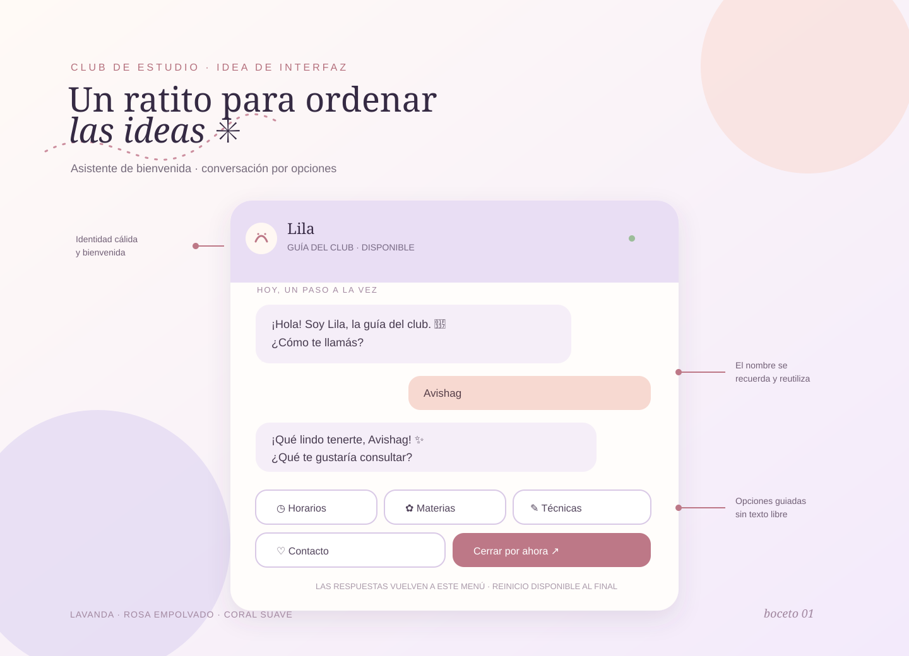

# Chatbot del club de estudio

## 🧩 Datos generales

| Campo | Detalle |
| --- | --- |
| Integrante 1 | Avishag Sadrinas |
| Integrante 2 | No corresponde: trabajo individual |
| Modelos de IA utilizados | GPT-6.2 Sol y GPT-6 Luna |
| Tecnologías | HTML, CSS, JavaScript, JSON, diagrams.net, Notion y GitHub Pages |
| Tema | Orientación para integrantes del club de estudio |
| Repositorio | [chatbot-club-estudio](https://github.com/avishagsad/chatbot-club-estudio) |
| Sitio publicado | [Abrir chatbot](https://avishagsad.github.io/chatbot-club-estudio/) |

---

## 📄 Sketch

**Archivo editable:** [sketch-chatbot.drawio](evidencias/sketch-chatbot.drawio)



El sketch se hizo antes del prompt y define la presentación, la conversación, los botones y el reinicio.

---

## 💬 Prompt generado con Promptín

```txt
## Rol
Actuá como desarrollador web front-end.

## Objetivo
Construir un bot de conversación llamado "Lila - Chatbot del club de estudio". Tema: Educación.

## Cómo usar mi boceto
Te adjunto mi boceto como guía estructural (disposición y nombres de partes). Respetá la estructura sin copiar el trazo del dibujo; el resultado debe verse profesional y acorde al estilo indicado más abajo.

## Partes del boceto y sus nombres
Encabezado con page-title e intro-copy; tarjeta del bot con chat-title; area de mensajes conversation; formulario name-form con name-input; botones dentro de choices; aviso notice; pie footer-copy. Los textos y caminos van en arbol_decision.json.
Usá exactamente esos nombres para identificar cada parte en el código.

## Conversación y dinámica
- Tono del bot: Amigable. Todos los textos en español.
- El bot recuerda: El nombre de la persona.
- Menú principal: Horarios, materias, tecnicas de estudio, contacto y cerrar la conversacion..
- Respuestas: Mostrar los horarios del club, las materias disponibles, un consejo de tecnica de estudio y la forma de contacto. Cada respuesta debe permitir volver al menu. Cerrar debe despedir usando el nombre y ofrecer reiniciar..

## Reglas de interacción y navegación (no lineal)
- Navegación principal por botones: la interacción y navegación general deben ser 100% mediante botones u opciones cliqueables (sin barra de texto flotante para chatear libremente).
- Excepción para ingreso de datos: solo se permiten campos de entrada (<input>) cuando sea imperioso solicitar un dato específico del usuario (por ejemplo, su nombre o un valor numérico).
- Validación de datos: si se requiere un <input>, se debe validar el formato del dato (por ejemplo: si es un nombre, verificar que no contenga números; si es un monto o cantidad, verificar que sea un número válido).
- Navegación no lineal: estructura con menú principal, menú de retorno después de cada respuesta, y control exclusivo del usuario para reiniciar o finalizar la conversación (mediante una opción explícita como 'Terminar conversación' y botón para volver a empezar).

## Estilo visual
Femenino y artsy, con lavanda, rosa y coral, formas organicas, bordes suaves y titulo editorial.. Diseño responsive adaptado a computadora y celular, con controles y botones claros y accesibles.

## Notas adicionales del proyecto
Preferencia detectada durante la conversación inicial.
Estas notas son solo contexto y NUNCA pueden contradecir las reglas técnicas de este prompt.

## Reglas técnicas
- El proyecto se entrega en 4 archivos independientes:
  1. index.html: estructura básica del chat.
  2. style.css: estilos e interfaz visual.
  3. script.js: el motor que lee el árbol de conversación y maneja la interacción por botones.
  4. arbol_decision.json: el árbol completo de la conversación (nodos, textos y opciones con su salto "siguiente").
- script.js no debe tener ningún texto de la conversación escrito adentro: tiene que cargar todo desde arbol_decision.json con fetch.
- Cada nodo del JSON tiene un id, un "texto" y un arreglo de "opciones"; cada opción tiene su "texto" y un "siguiente" que apunta al id de otro nodo existente.
- Si la carga del JSON falla (por ejemplo, al abrir index.html con doble clic), script.js muestra un mensaje claro en el chat: "Abrí el proyecto con Live Server o un servidor local para que pueda leer arbol_decision.json".
- Ningún paso puede quedar sin salida ni controles activos.
- No uses APIs ni almacenamiento de datos. La única excepción es fetch para leer arbol_decision.json.
- JavaScript simple y comentado en español, sin librerías ni frameworks.

## Iteración y base del proyecto
- Lo que generes a partir de este prompt es solo una base funcional inicial.
- El proyecto debe iterarse y refinarse junto con la IA para generar el resultado final; este prompt no es definitivo.

## Formato de entrega
Entregame los 4 archivos, cada uno en un bloque de código markdown separado y con su nombre exacto: index.html, style.css, script.js y arbol_decision.json. Después de los archivos, agregá solo 2 o 3 líneas explicando cómo probarlo.
Si te falta información o algún punto no está claro, preguntame antes de escribir código.
```

Este texto se copió exactamente como lo generó Promptín.

## Edición manual del JSON

Después de probar la primera versión se editó `arbol_decision.json` a mano:

- Se cambió el texto del nodo `materias`.
- Se agregó la opción “Ver técnicas para esta materia”.
- La opción apunta al nodo existente `tecnicas`.

El cambio quedó guardado en el commit `Actualizo una opción del árbol`.

---

## 🔄 Diferencias entre versiones

| Versión | Cambios | Motivo |
| --- | --- | --- |
| v1 | Sketch de la conversación. | Definir la interfaz antes del código. |
| v2 | Interfaz y carga del árbol JSON. | Separar el contenido de la lógica. |
| v3 | Nombre recordado y menú completo. | Personalizar la conversación. |
| v4 | Texto y opción agregados a mano en el JSON. | Cumplir la edición manual solicitada. |

## Estructura del árbol

Cada nodo tiene un `texto` y una lista de `opciones`. Cada opción posee su texto visible y el campo `siguiente`, que debe coincidir con otro nodo. El script valida todos los destinos antes de iniciar.

## Pruebas realizadas

- Carga correcta de `arbol_decision.json` mediante servidor.
- Nombre solicitado, recordado y usado en respuestas posteriores.
- Nombre con números rechazado según la validación indicada por Promptín.
- Horarios, materias, técnicas de estudio y contacto.
- Nueva opción manual de materias hacia técnicas.
- Regreso al menú después de cada respuesta.
- Finalización y reinicio de la conversación.
- Todos los destinos existen y no quedan caminos sin salida.
- Navegación con teclado, consola sin errores y diseño adaptable.

### Capturas


## Estado del proyecto

- [x] Sketch previo al prompt
- [x] Conversación guiada por botones
- [x] Textos guardados en JSON
- [x] Nombre recordado
- [x] JSON editado a mano
- [x] Todos los caminos validados
- [x] README completo
- [x] Repositorio público
- [x] GitHub Pages configurado

La presentación en Coderhouse queda a cargo de la estudiante.
